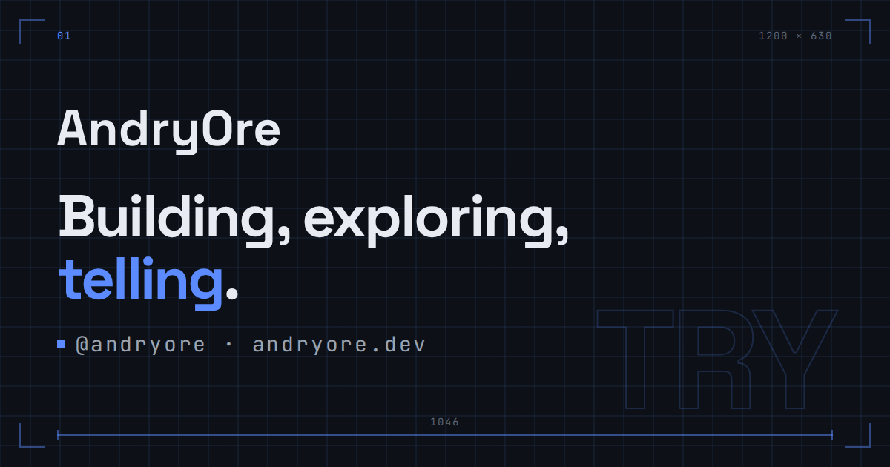

<div align="center">

<picture>
  <source media="(prefers-color-scheme: dark)" srcset="docs/brand/logo/wordmark-white.svg">
  <source media="(prefers-color-scheme: light)" srcset="docs/brand/logo/wordmark.svg">
  
</picture>

<br>
<br>



**The source of andryore.dev, the personal site of Andry Orellana.**

[Website](https://andryore.dev) · [Documentation](docs/README.md)

[![CI][badge-ci]][link-ci] [![Lighthouse][badge-lighthouse]][link-lighthouse]
[![License][badge-license]][link-license]
[![Website][badge-website]][link-website]

Built with [Astro](https://astro.build) 7 ·
[TypeScript](https://www.typescriptlang.org) 6 ·
[Tailwind CSS](https://tailwindcss.com) 4 · [React](https://react.dev) 19 ·
[Bun](https://bun.sh) 1.4

</div>

## About

andryore.dev is a static Astro site in English and Spanish where Andry writes
down what he builds, what worked and what did not. It holds a page for each
product and contribution, plus the tools and setup he uses day to day:

- **Snug**: a browser extension to export, import and back up bookmarks.
- **Animated Fluent Emojis**: Microsoft's animated Fluent emojis as one
  component.
- **JSON Flow**: a VS Code extension that turns JSON, YAML, XML and CSV into
  interactive graphs. A contribution: Andry built its marketing site and parts
  of the webview.
- **Uses**: the tools, tech and setup behind what he builds and streams.

## Quick start

You need [Bun](https://bun.sh) `1.4.2`; see
[prerequisites](docs/development.md#prerequisites).

```sh
bun install
bun run dev
```

Then run the checks before you push:

```sh
bun run check
bun run test
```

Details are in [Running locally](docs/development.md#running-locally) and the
[script reference](docs/development.md#scripts).

## Project structure

```text
src/
  pages/        Astro routes, English at the root and Spanish under es/
  content/      Page copy as JSON and the product pages as Markdown
  components/   Astro components and the few React islands
  layouts/      Page shells
  lib/          Client and build-time logic
  i18n/         Locale helpers and parity checks
  seo/          Crawler policy and llms.txt
  styles/       Tailwind entry and design tokens
docs/           Guides, ADRs and the public brand kit
scripts/        Repo scripts and their tests
eslint-rules/   Local ESLint rules
e2e/            Playwright tests
docker/         Production image files
```

## Documentation

| Doc                                        | Covers                                         |
| ------------------------------------------ | ---------------------------------------------- |
| [Contributing](CONTRIBUTING.md)            | How to propose and land a change               |
| [Development](docs/development.md)         | Setup, scripts, tests, CI, releasing           |
| [Configuration](docs/configuration.md)     | Environment variables and the dotenvx workflow |
| [Troubleshooting](docs/troubleshooting.md) | Common failures, their causes and fixes        |
| [Architecture](docs/architecture.md)       | How the Site is built, served and deployed     |
| [Security](docs/security.md)               | Threat model, headers, secrets                 |
| [Design](DESIGN.md)                        | The public design context                      |
| [Accessibility](ACCESSIBILITY.md)          | Commitments and how they are checked           |
| [Roadmap](ROADMAP.md)                      | Where the project is heading                   |
| [Changelog](CHANGELOG.md)                  | What changed in each release                   |
| [Governance](GOVERNANCE.md)                | Who decides what and how                       |
| [Decisions](docs/adr/README.md)            | Architecture decision records                  |
| [Brand kit](docs/brand/README.md)          | Public logo, tokens, OG and avatar assets      |
| [Agent rules](AGENTS.md)                   | Rules and conventions for coding agents        |

## Contributing

Open an issue first, then send a pull request against `develop`. The
[contributing guide](CONTRIBUTING.md) covers the rest, and everyone follows the
[Code of Conduct](CODE_OF_CONDUCT.md).

## Forking this repo

You may learn from the code and reuse it under the MIT license. Do not republish
the design, the brand or the content as your own; they are not covered by it.
See [LICENSE](LICENSE) and [ADR 0007](docs/adr/0007-split-license.md).

## License

The source code is licensed under [MIT](LICENSE).

[badge-ci]:
  https://github.com/AndryOre/andryore-web/actions/workflows/ci.yml/badge.svg
[badge-lighthouse]:
  https://github.com/AndryOre/andryore-web/actions/workflows/lighthouse.yml/badge.svg
[badge-license]: https://img.shields.io/github/license/AndryOre/andryore-web
[badge-website]: https://img.shields.io/website?url=https%3A%2F%2Fandryore.dev
[link-ci]: https://github.com/AndryOre/andryore-web/actions/workflows/ci.yml
[link-lighthouse]:
  https://github.com/AndryOre/andryore-web/actions/workflows/lighthouse.yml
[link-license]: LICENSE
[link-website]: https://andryore.dev
